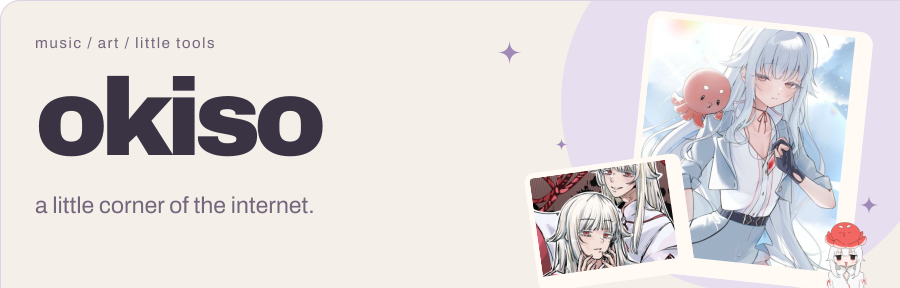

<picture>
  <source media="(prefers-color-scheme: dark)" srcset="assets/profile/header-dark.svg">
  
</picture>

### hey, i'm okiso ♡

i make original music, art, and little tools i want to use.

**[my world ↗](https://oki.so)** · **[listen ↗](https://oki.so/releases)** · [discord](https://discord.com/users/274178934143451137) · [anilist](https://anilist.co/user/okiso)

## a little something i made

### [backdrop ↗](https://github.com/okisooo/backdrop)

**your ai workspace, with your own wallpaper.**

images and animated gifs behind **claude desktop, codex desktop, and t3 code**, with blur and readability controls. one small windows tray app.

<a href="https://github.com/okisooo/backdrop"><picture></picture></a>

**[download for windows ↗](https://github.com/okisooo/backdrop/releases/latest/download/Backdrop-win-x64.zip)** · [see how it works](https://github.com/okisooo/backdrop#readme) · [watch the video](https://github.com/okisooo/backdrop/releases/download/v2.0.0/real-app-demo.mp4)

free & open source · runtime included · the demo contains no private chats

### more things to explore

| project | a little about it |
| :--- | :--- |
| **[fleet ↗](https://github.com/okisooo/fleet)** | ai usage, quotas, and reset times in one windows tray app. **[download](https://github.com/okisooo/fleet/releases/latest)** |
| **[practice room ↗](https://nihongo.okiso.net)** | short language-practice rounds for reading, writing, listening, and recall. **[source](https://github.com/okisooo/NihongoRevisionSuite)** |
| **[oki.so ↗](https://oki.so)** | my music, artwork, releases, and the rest of my little world. **[source](https://github.com/okisooo/site)** |

## music & art

<a href="https://oki.so/releases"><picture>
  <source media="(prefers-color-scheme: dark)" srcset="https://profile.oki.so/release.svg?theme=dark&accent=a18ab8&v=3">
  
</picture></a>

## off the clock ♡

<a href="https://discord.com/users/274178934143451137"><picture>
  <source media="(prefers-color-scheme: dark)" srcset="https://profile.oki.so/presence.svg?theme=dark&accent=a18ab8&v=3">
  
</picture></a>
<a href="https://osu.ppy.sh/users/oxo7"><picture>
  <source media="(prefers-color-scheme: dark)" srcset="https://profile.oki.so/osu.svg?theme=dark&accent=a18ab8&v=3">
  
</picture></a>

<a href="https://anilist.co/user/okiso"><picture>
  <source media="(prefers-color-scheme: dark)" srcset="https://profile.oki.so/anime.svg?theme=dark&accent=a18ab8&v=3">
  
</picture></a>

favorite characters ♡

<a href="https://anilist.co/user/okiso/favorites"><picture>
  <source media="(prefers-color-scheme: dark)" srcset="https://profile.oki.so/characters.svg?theme=dark&accent=a18ab8&v=3">
  
</picture></a>

a few github stats

 

thanks for stopping by — make yourself at home ♡

art by suyosuyo, sobu · @sobsocks & 7mmchan · [live cards](https://profile.oki.so)

